# Living Brain UI/UX レポート

対象: `livingbrain.com`（マーケティング）、`docs.livingbrain.com`（ドキュメント）、`livingbrain.com/workspace`（プロダクト）
手法: REA による受動的ブラウザ観測＋CDP計測＋ユーザー提供スクリーンショット
実施日: 2026-11-06〜07

> **証拠の区分**
> - **Tier A（自力観測）**: 本リポジトリの `screenshots/ui-*.webp`。CDP で撮影し、DOM・計算スタイルを実測。
> - **Tier B（ユーザー提供）**: ログイン後のアプリ画面。依頼者が撮影したスクリーンショットを参照（§8）。ファイルは未収録。
> - 数値は `evidence/ui-audit-*.json` に生データあり。**観測 / 推測 / 不明**を明記する。

---

## 0. 30秒サマリ

Living Brain の UI は、**「マーケティング」「料金」「ドキュメント」「アプリ」で別々の視覚言語**を持っています。

- マーケティング: 黒＋オレンジ、ChatSans、巨大な余白、WebGLのヒーロー
- 料金: 白＋紫、同じ書体、情報密度が高い
- ドキュメント: 黒＋紫、見出しだけ太い（ChatSansHeading）
- アプリ: 白＋紫＋黒、サイドバー型、情報密度が非常に高い

それぞれ単体では良くできていますが、**横に並べると同一製品に見えません**。加えて、スティッキーヘッダーが透明のまま白文字で固定されるため、明るいセクション上でナビが読めなくなる箇所があります（実測）。

一方で、**オンボーディングはこの製品で一番よくできています**。創業者の手紙、数字の提示、そして「できないこと（Limitations）」まで並べた上で「Create My Living Brain」に繋ぐ流れは、記憶製品に必要な信頼の作り方として参考になります。

---

## 1. 画面の全体像

```
┌──────────────────────────────────────────────────────────────┐
│ livingbrain.com          マーケティング（黒 / オレンジ）      │
│  ├─ ヒーロー（WebGL・14ノードの探索）                        │
│  ├─ ベンチマーク（白セクション・オレンジ）                    │
│  ├─ 連携（端末モック・Claude）                                │
│  ├─ Markdown Quality Score（黒）                              │
│  ├─ FAQ / CTA（白 → 黒）                                      │
│  └─ 料金（白 / 紫）                                           │
├──────────────────────────────────────────────────────────────┤
│ docs.livingbrain.com     ドキュメント（黒 / 紫 / Fern生成）    │
├──────────────────────────────────────────────────────────────┤
│ livingbrain.com/signin   サインイン（白 / 紫 / マーケの装飾）  │
│ livingbrain.com/workspace アプリ入口（白 / 紫 / 極端に簡素）   │
└──────────────────────────────────────────────────────────────┘
```

**観測**: 同じ「Sign in」でも2種類の画面が存在します。マーケティング側の `/signin` はフッター付きのブランドページ、`/workspace` はロゴとボタンだけのアプリ入口です（Tier B のスクリーンショットで両方確認）。導線によって見た目が変わるため、ユーザーは「別のサービスに来た」と感じる可能性があります（推測）。

---

## 2. ビジュアルシステム（実測）

| 項目 | マーケティング | 料金 | ドキュメント | アプリ |
|---|---|---|---|---|
| 背景 | 黒 `lab(1.9 …)` | `#f8f8f7` | `#0a0a0a` | `#f8f8f7` |
| アクセント | オレンジ（ロゴ・数値） | 紫 `#5b4bf5` 系 | 紫 | 紫＋黒 |
| 書体 | ChatSans | ChatSans | ChatSans / ChatSansHeading | ChatSans |
| h1 | 56px / **500** | 60px / 500 | 56px / **700** | 24px / 500 |

**観測**: 書体は統一されていますが、**見出しの太さが 500 と 700 で違います**。マーケティングは細く上品、ドキュメントは太く実務的。これは意図的な差別化にも見えますが、ブランドの一貫性としては弱まります。

**観測**: 主ボタンの色が3種類あります。

- 黒: `Create project`、`Subscribe to Workspace`、`Send invite`、`Create New Brain`
- 紫: `Sign in`、`Create key`、`Register webhook`、`Continue`
- 白（黒文字）: ヒーローの `Create Account`

同じ画面内で「黒が主・紫が副」なのか「紫が主・黒が副」なのかが一定しません（Tier B のスクリーンショットで確認）。

---

## 3. マーケティングサイト

### 3.1 ヒーロー

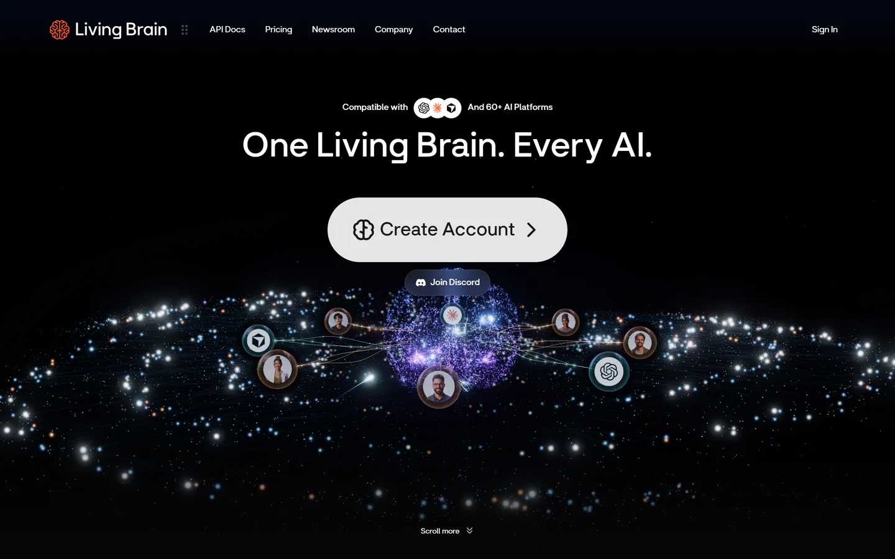

- 「One Living Brain. Every AI.」56px / weight 500
- 白い巨大ピル `Create Account`、その下に `Join Discord`
- 「Compatible with [3ロゴ] And 60+ AI Platforms」
- 下部に `Scroll more`

**観測**: ヒーローは WebGL の粒子表現で、**14個のクリック可能なノード**（Sir Atlas / Claude / Nova / Kevin / ChatGPT / David / Nikita / Cursor / Iris / Memory MCP / Orion / Search MCP / Vega / Files MCP）を持ちます。各ノードは `<button>` で、アクセシブル名は「Show information for Claude」のように具体的です。装飾ではなく**探索UIとして実装されている**点は評価できます。

**推測**: 初見では「何ができるか」より「きれいな宇宙」が先に立ちます。CTAは明確なので致命的ではありませんが、価値の説明はスクロール後（約2,300px）まで出てきません。

### 3.2 スクロール構成

| 位置 | セクション | 背景 | 内容 |
|---|---|---|---|
| 0 | ヒーロー | 黒 | 主張＋CTA＋探索ノード |
| 1,900 | Powered by the best of modern AI | 白 | Anthropic / OpenAI / Google / NVIDIA |
| 2,300 | Better memory, measured daily | 白 | 92.2%、22.6X、95%、0%、94.7%、464ms |
| 3,400 | Bring your Living Brain everywhere | 白 | Claude 端末モック＋連携説明 |
| 4,175 | Watch what Living Brain can do | 白 | 動画（Christel） |
| 5,025 | Powerful Agents | 白→黒 | エージェント訴求 |
| 5,826 | Markdown Quality Score | 黒 | 5つのスコア（MQS/MWS/PFS/CRS/RPS） |
| 8,461 | Your agents get thing done | 黒 | 成長の可視化 |
| 12,169 | Good questions, straight answers | 白 | FAQ＋問い合わせカード |
| 12,959 | Build your first Living Brain | 黒 | 最終CTA |

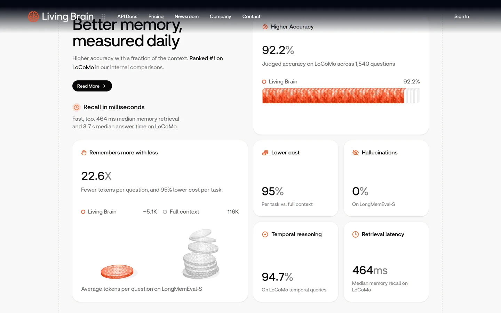

**観測**: 数値カードは「アイコン＋見出し＋巨大な数字＋補足」の4層で統一され、視線が数字に落ちます。22.6X のカードには**3Dのコイン比較**（オレンジ1枚 vs 灰色の山）が添えられ、数字を図で補っています。ここは非常に良い設計です。

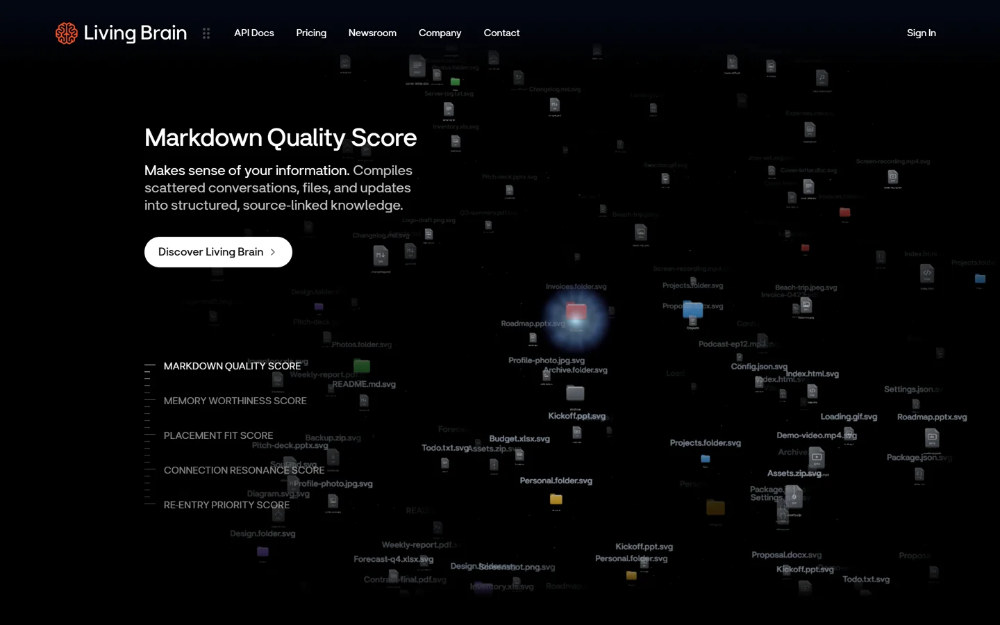

**観測**: 「Markdown Quality Score」セクションは、散らばったファイル（PNG/PPTX/XLSX/JSON/SVG）が暗い空間に浮かぶ表現で、5つのスコアを左に列挙します。抽象的な概念を「散らかった情報が整理される」という視覚に置き換えていて、マーケティングとして効果的です。

### 3.3 料金

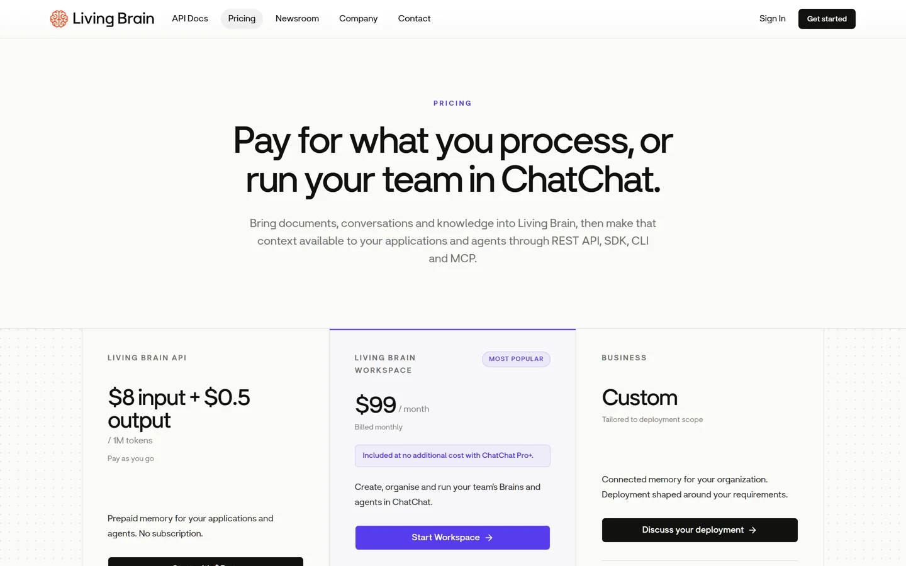

- 「Pay for what you process, or run your team in ChatChat.」60px
- 3列: `$8 input + $0.5 output / 1M tokens`、`$99 / month`（MOST POPULAR）、`Custom`
- 中央カラムだけ紫の枠と淡い背景

**観測**: 単位が列ごとに違います（トークン従量 / 月額 / 見積）。並列に置かれているのに比較軸が揃っていないため、「どれが自分に安いか」を計算できません。3列のカードは同じ高さですが、中身の構造（価格→説明→ボタン）は揃っています。

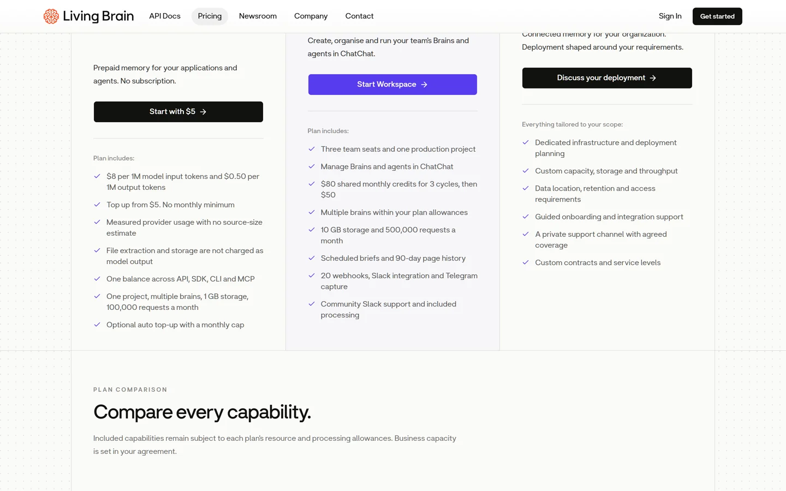

**観測**: `MOST POPULAR` バッジは紫。ただし `Start Workspace` も紫、`Discuss your deployment` は黒。強調の順序が色だけでは読み取れません。

### 3.4 FAQ とフッター

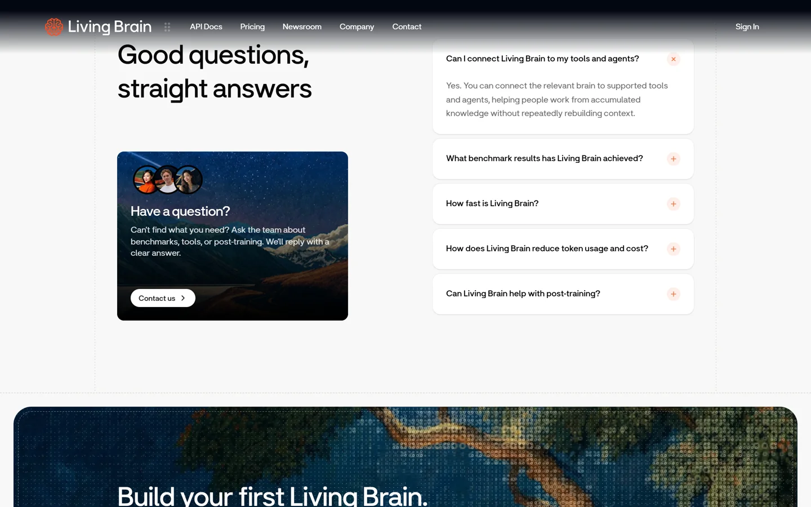

- 左に「Have a question?」カード（3人のアバター＋山の写真＋`Contact us`）
- 右にアコーディオン5件。開閉アイコンは `+` / `×`
- 下に世界地図のピクセルアートで最終CTA

**観測**: アコーディオンは1件目が開いた状態で、閉じている項目にも `+` が出ます。アイコンの意味（開く／閉じる）が状態と一致していて分かりやすい。

---

## 4. スティッキーヘッダーの問題（実測）

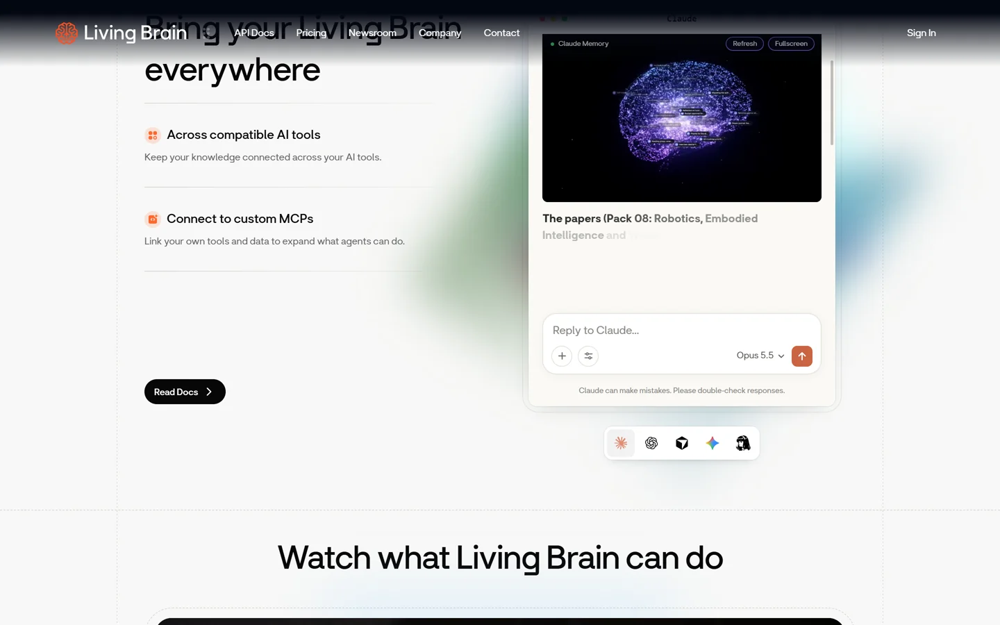

**観測（実測）**:
- `header` は `position: sticky`、高さ 96px
- 背景は `rgba(0, 0, 0, 0)`（完全透明）、リンク色は `rgb(255, 255, 255)`、**スクロール位置 0 / 2250 / 3400 / 5000 / 5800 のすべてで同じ**
- 明るいセクションの上では、白文字が白背景に乗る

スクリーンショット（3,400px）では、ナビの文字が本文の見出し「Bring your Living Brain everywhere」と重なり、判読できません。上部に暗いグラデーションのスクリムが出るセクション（2,250px、12,100px）では読めますが、**セクションによって可読性が変わる**のは設計として不安定です。

> 推測: スクリムはセクション側の装飾として存在し、ヘッダーが自分の背景を持っていないため、セクションの切り替わりで可読性が落ちます。

**影響**: ナビゲーションは全ページ共通の主要導線なので、ここが読めない時間帯があるのは優先度の高い欠陥です。

---

## 5. ドキュメント（Fern 生成）

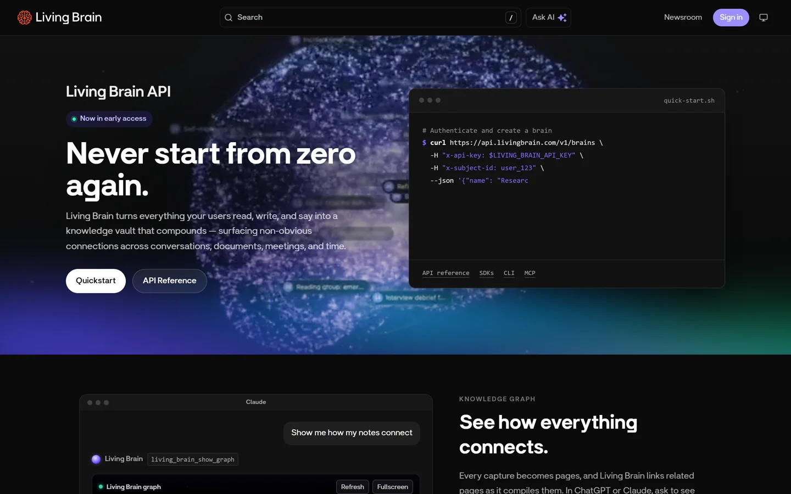

- 黒背景＋紫。上部に検索（`/` ショートカット）、`Ask AI`、`Newsroom`、`Sign in`
- 左にサイドバー、右に「On this page」
- ヒーローにコードブロック（`quick-start.sh`）と `API reference / SDKs / CLI / MCP` のリンク

**観測**: 検索にキーボードショートカット（`/`）が明示され、`Ask AI` が常設。開発者向けドキュメントとして必要な要素が揃っています。

**観測（実測）**: `Sign in` ボタンのコントラストが **2.7:1**（14px）。WCAG AA の 4.5:1 を下回ります。

---

## 6. アプリ入口（未ログイン）

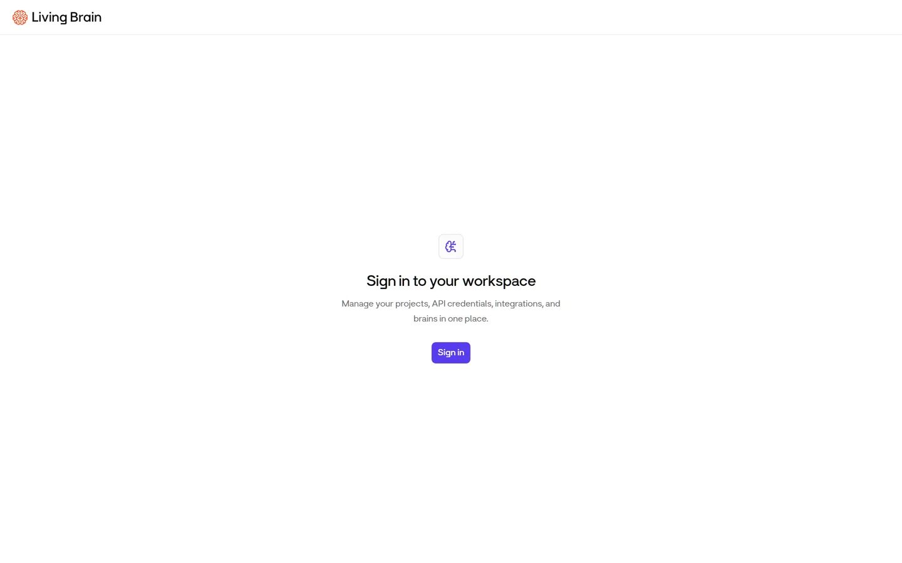

- ロゴ、中央にアイコン、`Sign in to your workspace`、説明、紫の `Sign in` ボタン
- それ以外は**完全な空白**

**観測**: 情報が3要素しかなく、初見だと「何のサービスか」「ログインすると何ができるか」が分かりません。直前のマーケティングページから来たユーザーには落差が大きいです。

---

## 7. アプリ（ログイン後）— ユーザー提供スクリーンショットより

> **Tier B**: 依頼者が撮影した画面（2026-11-07）。以下は画像から読み取った観測で、DOM計測はしていません。

### 7.1 シェル

```
┌───────────────┬──────────────────────────────────────────────┐
│ Living Brain  ▸│  ページタイトル                              │
│ えるすプライベート用 ▾                                        │
│               │  1行の説明                                    │
│ WORKSPACE     │  ┌────────────────────────────────────────┐  │
│  Home         │  │ 白いカード（枠線＋薄い影）              │  │
│  Projects     │  └────────────────────────────────────────┘  │
│  Brain        │                                              │
│  Billing & Team│                                             │
│ DEVELOPER     │                                              │
│  API keys     │                                              │
│  Webhooks     │                                              │
│               │                                              │
│ (Pay as you go)│                                             │
│ ユーザー / 設定 │                                             │
└───────────────┴──────────────────────────────────────────────┘
```

**観測**: サイドバーは「WORKSPACE」と「DEVELOPER」の2グループに分かれ、役割が明確です。下部に残高カード（`Pay as you go` / `1 of 1 brains - Upgra…` / 円形プログレス）、最下部にユーザーと設定。定番の構造で、迷いにくい。

**観測**: ページ見出し（例: `Webhooks`）＋1行説明＋白カードの繰り返しで、全ページが同じリズムです。情報密度は高いですが、余白が十分にあり読みやすい。

### 7.2 各画面

| 画面 | 内容 | 観察 |
|---|---|---|
| Webhooks | Delivery URL、イベント5種のチェックボックス（3列）、`Register webhook`（紫）、Subscriptions の空状態 | フォームのラベルは入力欄の上。空状態の文言が具体的 |
| API keys | 認証ヘッダーの説明、subject ID のコピー、Name / Purpose、`Create key`（紫）、一覧の空状態 | 「秘密は一度しか表示されない」と明記 |
| Billing & Team | 現在のプラン、Workspace へのアップグレード、残高 $0、プリペイド（$5/$20/$50/Custom）、利用量バー、チーム招待 | 利用量がオレンジのバーで、上限に対する現在値が併記される |
| Projects | プロジェクト選択、新規作成、ChatChat 同期、Danger zone | Danger zone は赤枠で分離。破壊的操作の置き場所として適切 |
| Brain | ヒーロー（`Play with your Living Brain`）、統計（Brains / Memories / Connections）、ブレインカード、Quickstart | 3Dの脳がブランドの視覚記号として機能 |

**観測（重複）**: `Home` と `Brain` の両方にブレインカードの一覧が出ます。Home は「ヒーロー＋一覧＋Quickstart」、Brain は「統計＋一覧」。初見では「どちらが本来の入口か」が分かりません。

**観測（単位の不統一）**: 利用量の行で `Projects 1 / 1`、`Seats 1 / 1`、`API keys 0 / 3` と上限が数字なのに対し、`Brains 1 / no fixed cap` だけ文字列です。同じ表の中で表現が混ざっています。

**観測（通知）**: 画面上部に `Number #1 in Locomo` のバナーが常設されます。マーケティングの主張をプロダクト内に持ち込む例で、信頼の補強になりますが、作業中は視界に入り続けます（閉じられるかは不明）。

### 7.3 オンボーディング「Meet Your Living Brain」

**観測**: 左右分割。左は創業者からの手紙（`WELCOME TO LIVING BRAIN` / `Meet Your Living Brain` / 3段落 / 署名 `Christel B.` / Founder）。右は `Benefits`（92.2%、22.6X、95%、0、**+7.8pts**、**4.9X**）、`How it works`（3項目のアコーディオン）、`Limitations`（3項目）、`Ready to test our claims?` → `Create My Living Brain`。

これは**この製品で最も優れたUI**です。理由は3つ。

1. **主張の前に「誰が言っているか」を置いている**（署名）
2. **数字を出した直後に「できないこと」を並べている**（Limitations: 「与えたものしか知らない」「チャットアプリではない」「古い記憶は指示するまで残る」）
3. **最後に「試してみる」に繋ぐ**（`Ready to test our claims?`）

記憶製品は「何を覚えているか分からない」不安が導入障壁になるので、Limitations を先に出すのは合理的です。

**観測（新情報）**: ここで `+7.8pts Accuracy gained On LoCoMo since Oct 5`、`4.9X Questions judged LoCoMo set, all valid` という、公開サイトには無い指標が使われています。マーケティングとプロダクトで数字のセットが違います。

---

## 8. レスポンシブ

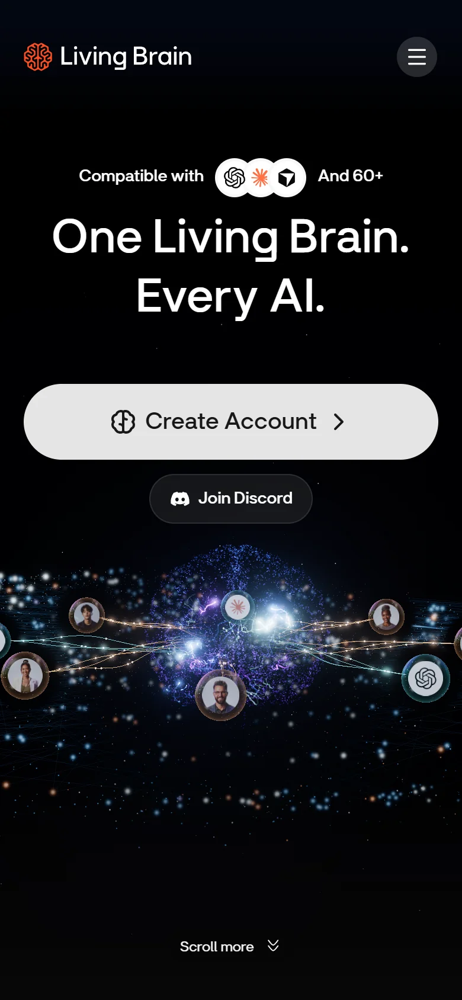

**観測**: 390px でもレイアウトは破綻せず、横スクロールも出ません（実測 `scrollWidth == innerWidth`）。ハンバーガーはグレーの円形ボタンで、開くと黒いパネルに5項目＋Sign In が並びます。

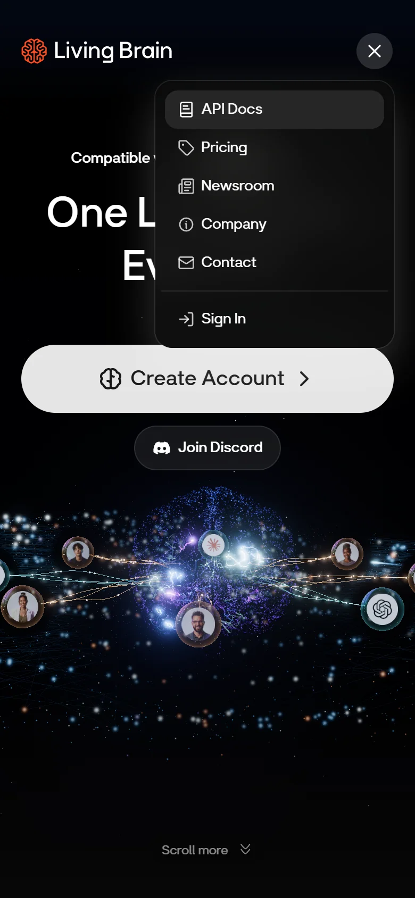

**観測（文言の欠落）**: ヒーローの「Compatible with [ロゴ] And 60+ AI Platforms」は、モバイルで **`AI Platforms` の span が `display: none`** になります。結果、画面には「And 60+」だけが残り、**文が途中で終わって見えます**。

**観測**: 料金ページのモバイルは1列に積まれ、`$8 input + $0.5 output` が大きく表示されます。読みやすいですが、3プランの比較は縦スクロールになります。

---

## 9. アクセシビリティ監査（実測）

`scripts/audit.js` を各ページで実行（生データ: `evidence/ui-audit-*.json`）。

| ページ | h1 | 見出し飛び | alt欠落 | コントラスト不合格 | 24px未満の操作要素 |
|---|---|---|---|---|---|
| ホーム | **2** | 1（h1→h4） | 0 / 10 | 1 / 300（3.29:1） | 16 / 121 |
| 料金 | 1 | 1 | — (画像0) | 0 / 157 | 7 / 23 |
| ドキュメント | 1 | 0 | 0 / 1 | **1 / 73（2.7:1）** | 16 / 62 |
| ワークスペース入口 | 1 | 0 | — | 0 / 2 | 0 / 3 |

**観測（REA のアクセシビリティツリー）**
- ランドマーク: `main` が**2つ**、`navigation` が**2つ**（いずれも名前なし）
- 見出し27個のうち**8個が名前なし**
- `Section transition preview` という名前のリージョンが3つ（開発用の名残と推測）
- ホームの h1 は2つ（可視の1つ＋`sr-only` の「Living Brain V2」）

**観測（DOM）**
- セクション見出しが**デスクトップ用とモバイル用で二重化**（例: `Watch what Living Brain can do` と `Watch what\nLiving Brain can do`）。アニメーション用の複製と推測。アクセシビリティツリー上は重複が検出されていないため、読み上げへの影響は限定的と判断。

**観測（コピー）**
- `Your agents get thing done.` — 文法エラー（`things` が正しい）。h2 として画面に表示される。

---

## 10. 発見した問題（重大度順）

| # | 問題 | 重大度 | 証拠 |
|---|---|---|---|
| 1 | スティッキーヘッダーが透明＋白文字で、明るいセクション上で読めない | 高 | 実測＋`ui-06` |
| 2 | サインインが2系統（`/signin` と `/workspace`）で見た目もフローも違う | 高 | Tier B |
| 3 | 主ボタンの色が3種（黒・紫・白）で優先順位が不明 | 高 | Tier B |
| 4 | モバイルで「And 60+」と文が途切れる（`AI Platforms` が非表示） | 中 | 実測＋`ui-15` |
| 5 | `Home` と `Brain` で同じブレイン一覧が重複 | 中 | Tier B |
| 6 | h1が2つ、`main`が2つ、無名の`navigation`が2つ | 中 | 実測 |
| 7 | ドキュメントの `Sign in` が 2.7:1（AA不合格） | 中 | 実測 |
| 8 | コピーの文法ミス「get thing done」 | 中 | 実測 |
| 9 | 見出し27個中8個が無名（a11yツリー） | 低 | 実測 |
| 10 | 料金の単位が列ごとに違う（トークン／月／見積） | 低 | `ui-04` |
| 11 | 利用量の上限表記が混在（`1 / 1` と `no fixed cap`） | 低 | Tier B |
| 12 | マーケとプロダクトで数値セットが違う（+7.8pts / 4.9X は公開サイトに無い） | 低 | Tier B |
| 13 | `Section transition preview` がリージョン名として露出 | 低 | 実測 |

---

## 11. 改善提案

### P0: ヘッダーに自分の背景を持たせる
スクロール位置に関係なく読めるよう、`backdrop-filter` ＋半透明の背景（例: `rgba(10,10,10,.72)` ＋ `blur(12px)`）をヘッダー自身に持たせます。セクション側のスクリムに依存しない構造にすべきです。

### P0: サインインを1本化する
`/signin` と `/workspace` のどちらかを正とし、もう一方はリダイレクトにします。少なくとも見出し・ボタン・背景は同一にします。

### P1: 主ボタンの色を1つに決める
「紫＝主要操作」「黒＝破壊的または確定」「白＝マーケティング」のように役割を固定し、全画面で守ります。

### P1: モバイルの文言を直す
`AI Platforms` を非表示にするのをやめ、`And 60+ platforms` のように短い表現に差し替えるか、2行に折り返します。

### P2: Home と Brain の役割を分ける
Home は「次の行動」（Quickstart・最近のブレイン）、Brain は「一覧と管理」に限定します。

### P2: 見出し構造を整理する
`sr-only` の h1 を削除し、`main` を1つに、`nav` に `aria-label` を付けます。無名の見出し8個は、装飾要素を見出しから外すか `aria-hidden` にします。

### P3: コピーを校正する
`get thing done` → `get things done`。あわせて `Number #1 in Locomo` は `#1 on LoCoMo` に統一（表記ゆれ）。

---

## 12. 強み（残すべき点）

1. **オンボーディングの構成** — 手紙 → 数字 → 仕組み → 限界 → CTA。記憶製品の信頼設計として理想的
2. **数値カードの型** — アイコン＋見出し＋巨大数字＋補足。視線が数字に落ちる
3. **22.6X のコイン比較** — 抽象的なトークン削減を物で見せている
4. **ヒーローの探索UI** — 14ノードすべてがボタンで、アクセシブル名も具体的
5. **Quickstart の「OR FROM YOUR AI」** — コピペ用テンプレートで、既存のAIから入れる
6. **空状態の文言** — 「No API keys yet. Create one above.」のように次の行動を書いている
7. **Danger zone の分離** — 破壊的操作が赤枠で明確に区切られている

---

## 13. 限界

- **ログイン後の画面は自力観測していません**。§7 はユーザー提供スクリーンショットの読み取りで、DOM計測・コントラスト測定は未実施です
- スクリーンリーダーによる実読上げ、キーボード操作の通し検証は未実施
- Core Web Vitals（LCP / CLS / INP）は未測定。ただしホームは WebGL と 53 スクリプト・70 リソースを読み込むため、低性能端末では重い可能性があります（推測）
- A/B テストや意図の確認はできません。色の使い分けが意図的な場合もあります

---

## 14. 付録: スクリーンショット

| ファイル | 内容 |
|---|---|
| `ui-01-home-hero.webp` | ヒーロー（1440×900） |
| `ui-02-home-full.webp` | ホーム全体（1440×14038） |
| `ui-04-pricing-hero.webp` | 料金ヒーローと3プラン |
| `ui-05-metrics.webp` | ベンチマークカード群 |
| `ui-06-everywhere.webp` | ヘッダー衝突の証拠 |
| `ui-07-video.webp` | 動画セクション |
| `ui-08-agents.webp` | エージェント訴求 |
| `ui-09-markdown.webp` | Markdown Quality Score |
| `ui-10-faq.webp` | FAQ＋問い合わせ |
| `ui-11-pricing-cards.webp` | 料金カード |
| `ui-12-pricing-compare.webp` | 機能比較表 |
| `ui-13-docs-home.webp` | ドキュメント |
| `ui-14-workspace.webp` | アプリ入口 |
| `ui-15-mobile-home.webp` | モバイル ヒーロー |
| `ui-16-mobile-pricing.webp` | モバイル 料金 |
| `ui-17-mobile-menu.webp` | モバイル メニュー |

**Tier B（ユーザー提供、リポジトリ未収録）**: アプリの Home / Projects / Brain / Billing & Team / API keys / Webhooks、オンボーディング、`/signin`、モバイル表示。
